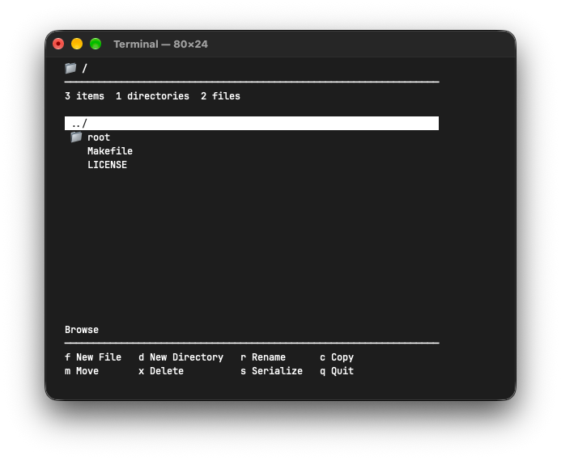

# CLI File Manager

Терминальная файловая утилита на C++20 для просмотра и изменения дерева файлов и каталогов.

## Внешний вид



## Возможности

- навигация по каталогам с помощью `↑` / `↓` и `Enter`;
- создание файлов (`f`) и каталогов (`d`);
- переименование (`r`), копирование (`c`), перенос (`m`) и удаление (`x`);
- сохранение текущего дерева в файл (`s`);
- выход из программы (`q`).

## Требования

- C++20;
- CMake 4.3 или новее;
- Unix-подобный терминал (используются `termios`, `poll` и `unistd`).

## Сборка и запуск

```bash
cmake -S . -B build
cmake --build build
cd build
./file_manager input.txt output.txt
```

Программа получает два аргумента: входной файл с описанием дерева и файл, в который будет записан результат. Пути интерпретируются относительно родительского каталога `build`.

## Формат дерева

Вложенность обозначается точками в начале строки. Имена каталогов заканчиваются символом `/`, имена файлов записываются без него:

```text
docs/
..README.md
..manual/
...usage.md
```

Лицензия в репозитории пока не указана.
